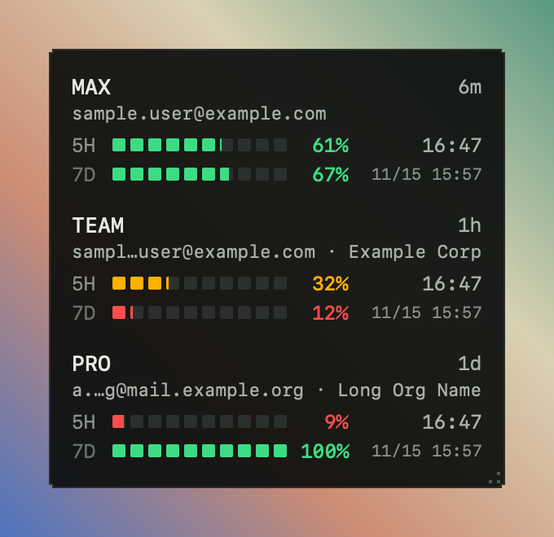
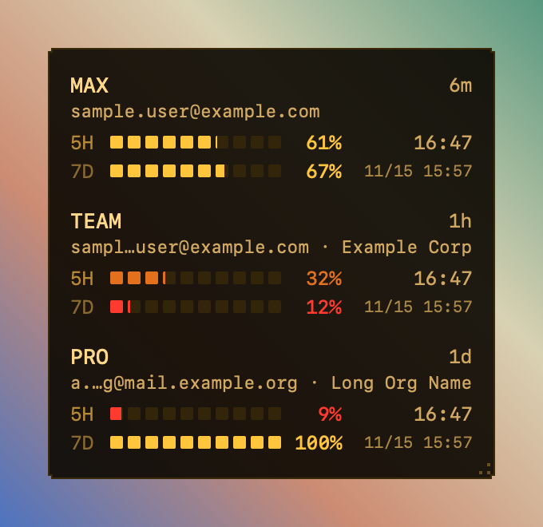
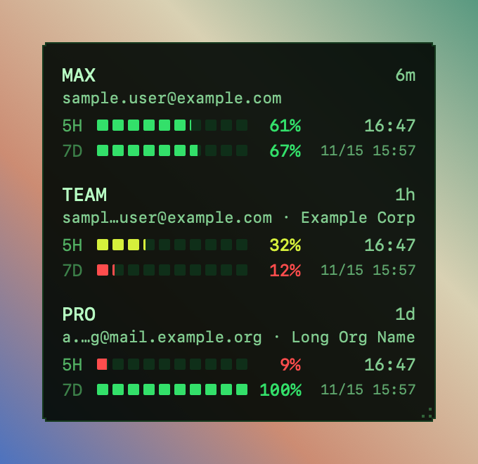
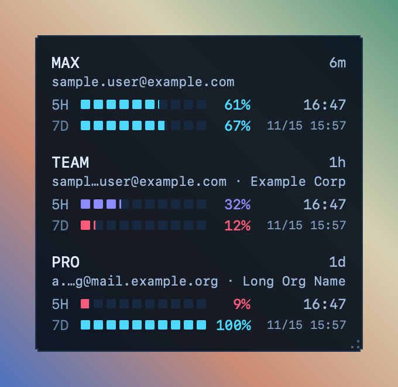
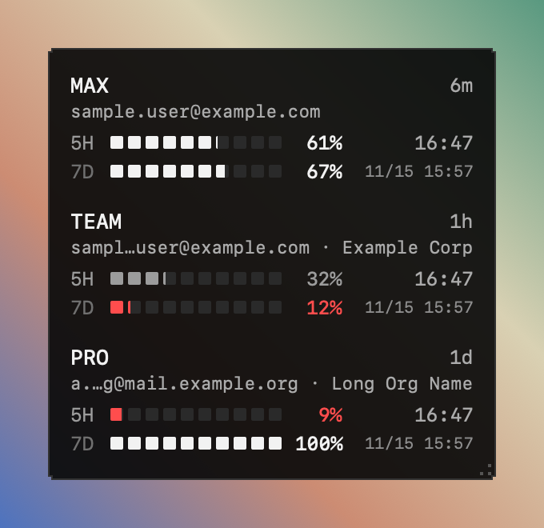
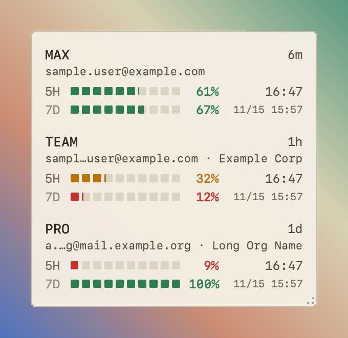

<div align="center">

# claude-usage-hp

**Claude 요금제 한도를 게임 HP 바처럼, 항상 화면에.**


[English](README.md) | 한국어



<sub>샘플 데이터, Terminal 테마.</sub>

</div>

## 왜 만들었나

Claude 요금제가 얼마나 남았는지 보려면 보통 브라우저에 사용량 페이지를 띄워 둬야 합니다. 이 프로젝트는 중요한 두 숫자, 즉 5시간 한도와 주간 한도의 남은 양을 항상 보이는 작은 HUD 와 메뉴 막대에 표시합니다. 기본으로는 로그인 토큰을 읽지 않습니다. 이 Mac 의 Claude Code 세션이 이미 전달받는 값만 기록합니다.

## 기능

- **여러 요금제를 한꺼번에.** 요금제마다 한 묶음으로 나오고, 같은 이메일 아래 요금제가 둘이어도 조직 단위로 나뉩니다.
- **5시간 / 주간 남은 양**을 네모난 점 10개 한 줄과 남은 % 로 표시합니다. 마지막으로 켜진 점은 일부만 채워질 수 있어서, 61% 는 점 6개와 일곱째 점의 일부입니다.
- **남은 양에 따른 색**: 50% 초과는 테마의 "정상" 색, 20~50% 는 경고 색, 20% 미만은 "부족" 색.
- **요금제와 계정 머리글.** 첫 줄은 대문자 요금제 이름 (`MAX`, `PRO`, `TEAM`, `ENTERPRISE`), 둘째 줄은 계정 이메일이고 조직에 실제 이름이 있으면 뒤에 붙습니다. 긴 이메일은 가운데를 줄여 도메인이 보이게 합니다.
- 한도마다 **리셋 시각**을 현지 시간으로 표시합니다. 오늘이 아니면 날짜도 함께 나옵니다.
- **값이 얼마나 오래됐는지** (`now`, `4m`, `2h`, `3d`) 표시해서, 오래된 숫자를 오래된 숫자로 알아볼 수 있습니다.
- **도트 매트릭스 터미널 스타일**: 모서리가 살짝 깎인 거의 검은 사각 패널에 고정폭 글꼴, 내장 색 테마 6종.
- **메뉴 막대 항목**: 가장 최근에 갱신된 요금제를 `5h 61% · 7d 67%` 처럼 보여 줍니다. 메뉴에는 HUD 숨기기 / 보이기, 테마, 서버에서 읽기, 종료가 있습니다.
- **항상 위에 떠 있는 HUD**: 키보드 포커스를 가져가지 않고, 모든 Space 와 전체 화면 앱 옆에 표시됩니다. 끌어서 옮길 수 있고, 오른쪽 아래 모서리로 크기를 바꿀 수 있습니다 (1.0배~2.5배). 위치와 크기를 기억하며, 메뉴에서 숨길 수 있습니다.
- `labels.json` 파일로 요금제 **이름을 직접 지정**할 수 있습니다 (선택).
- **기본으로는 토큰, 자격증명, 네트워크 없음.** 계정에 [서버에서 읽기](#서버에서-읽기-선택-기본은-꺼짐)를 켜지 않는 한 앱은 로컬 JSON 파일만 읽습니다.

메뉴 막대 항목의 메뉴는 한국어이고, HUD 자체는 짧은 영문 라벨을 씁니다.

## 테마

테마 6종이 내장돼 있습니다. 테마는 색만 바꾸고 배치는 모두 같습니다. 메뉴 막대 항목의 **테마** 하위 메뉴에서 고르며, 선택은 기억됩니다.

| Terminal | Amber | Phosphor |
| :---: | :---: | :---: |
|  |  |  |
| **Ice** | **Mono** | **Paper** |
|  |  |  |

이미지는 모두 샘플 데이터입니다. 기본값은 Terminal 이고, Paper 만 밝은 테마입니다.

## 동작 방식

```
Claude Code 세션
        │  응답마다 요금제의 한도 사용률이 함께 옴
        ▼
usage-hp mod  (화면에 아무것도 그리지 않음)
        │  최신 값을 요금제당 파일 하나로 기록
        ▼
~/.claude/usage-hp/<계정>__<조직>.json
        │  감시: 파일이 바뀌는 즉시 다시 읽음
        ▼
메뉴 막대 항목 + 플로팅 HUD
```

mod 는 Claude Code 안에서 돌고 자체 화면이 없습니다. macOS 앱은 Claude 나 어떤 서버와도 통신하지 않고, mod 가 적어 둔 값을 보여 주기만 합니다.

## 필요한 것

- macOS
- Xcode 명령줄 도구 (`swiftc` 용, `xcode-select --install`)
- Claude Code
- Claude 구독 요금제. API 키로 쓰는 계정은 5시간 / 주간 한도 값이 없어 표시되지 않습니다.

## 설치

1. 저장소를 받습니다.

   ```bash
   git clone https://github.com/dudwns0921/claude-usage-hp
   ```

2. mod 를 설치합니다. `<저장소 폴더>` 는 받은 폴더의 절대 경로입니다.

   ```bash
   claude plugin marketplace add <저장소 폴더>
   ```

   ```bash
   claude plugin install usage-hp@claude-usage-hp
   ```

3. 설정 폴더를 따로 쓰는 Claude Code 가 있으면 (`CLAUDE_CONFIG_DIR`) 그쪽에도 설치합니다. 플러그인은 설정 폴더마다 따로 설치됩니다.

   ```bash
   CLAUDE_CONFIG_DIR=<다른 설정 폴더> claude plugin marketplace add <저장소 폴더>
   ```

   ```bash
   CLAUDE_CONFIG_DIR=<다른 설정 폴더> claude plugin install usage-hp@claude-usage-hp
   ```

4. 앱을 빌드합니다.

   ```bash
   <저장소 폴더>/menubar/build.sh
   ```

5. 실행합니다.

   ```bash
   <저장소 폴더>/menubar/usage-hp-menubar &
   ```

6. 이미 열려 있던 Claude Code 세션은 다시 시작해야 mod 가 붙습니다. 세션이 응답을 한 번 받으면 그 요금제가 바로 나타납니다.

### 로그인할 때 자동으로 띄우기 (선택)

1. `menubar/com.local.usage-hp-menubar.plist.example` 을 `~/Library/LaunchAgents/com.local.usage-hp-menubar.plist` 로 복사합니다.
2. 복사한 파일의 `__BINARY_PATH__` 를 빌드된 `usage-hp-menubar` 의 절대 경로로 바꿉니다.
3. 실행 중인 앱을 끄고 등록합니다.

   ```bash
   pkill -x usage-hp-menubar
   ```

   ```bash
   launchctl bootstrap gui/$(id -u) ~/Library/LaunchAgents/com.local.usage-hp-menubar.plist
   ```

다시 끄려면:

```bash
launchctl bootout gui/$(id -u)/com.local.usage-hp-menubar
```

```bash
rm ~/Library/LaunchAgents/com.local.usage-hp-menubar.plist
```

## 사용법

- **HUD**: 아무 곳이나 끌어서 옮깁니다. 묶음 하나가 요금제 하나이고, `5H` 는 5시간 한도, `7D` 는 주간 한도입니다. 점과 숫자는 쓴 양이 아니라 **남은 양**입니다. 아직 값이 없으면 `측정값 없음` 한 줄만 나옵니다.
- **크기 조절**: HUD 오른쪽 아래 모서리의 작은 네모 세 개가 크기 조절 손잡이입니다. 끌면 HUD 전체가 같은 비율로 커지며, 1.0배(기본 크기이자 최소)부터 2.5배까지입니다. 두 번 클릭하면 1.0배로 돌아갑니다. 배율은 기억됩니다.
- **메뉴 막대 항목**: 제목은 가장 최근에 갱신된 요금제를 따르고, 남은 양이 50% 이하면 주황, 20% 미만이면 빨강이 됩니다. 요금제별 내용은 HUD 에만 나오고, 메뉴에는 아래 동작만 있습니다.
- **갱신은 즉시**: 앱이 `~/.claude/usage-hp/` 를 감시하다가 mod 가 값을 쓰는 순간 다시 그립니다. 누를 것이 없습니다. 30초 타이머는 파일 변경으로는 알 수 없는 것에만 남아 있습니다. 요금제 옆 갱신 시점이 늘어나는 것(`now` 에서 `1m`)과, 리셋 시각이 지난 한도가 100% 로 돌아가는 것입니다.
- **플로팅 창 숨기기 / 보이기**: HUD 를 숨기거나 다시 보입니다. 선택은 기억됩니다.
- **테마**: 색 테마를 바꿉니다.
- **서버에서 읽기**: Anthropic 서버에서 읽을 계정을 고릅니다. [아래](#서버에서-읽기-선택-기본은-꺼짐) 참고. 기본은 모든 계정이 꺼져 있습니다.
- **종료**: 앱을 끕니다.

### 표시 이름 바꾸기 (선택)

`~/.claude/usage-hp/labels.json` 을 만들면 요금제 이름을 직접 정할 수 있습니다. HUD 의 요금제 줄이 이 이름으로 바뀌며, 입력한 그대로 표시됩니다. 키는 조직 ID 이고, 같은 폴더에 있는 그 요금제 파일 안의 `organizationId` 값입니다.

```json
{ "<조직 ID>": "회사 팀" }
```

### 서버에서 읽기 (선택, 기본은 꺼짐)

mod 는 이 Mac 의 Claude Code 세션이 응답을 받을 때만 그 요금제의 값을 압니다. 주로 다른 곳(다른 기기, 원격 에이전트)에서 쓰는 요금제는 값이 오래된 채로 남습니다. 그런 요금제는 앱이 Anthropic 서버에 직접 묻게 할 수 있습니다.

- **켜기**: 메뉴의 **서버에서 읽기** 에서 계정을 체크합니다. 계정마다 따로이고, 체크하기 전에는 모든 계정이 꺼져 있습니다. 끄려면 체크를 풉니다. 이 Mac 에 터미널 로그인이 없는 계정은 비활성으로 나옵니다(`터미널 로그인 없음`).
- **기본 설정 폴더(`~/.claude`)의 로그인은 아직 지원하지 않습니다**: 그런 계정은 비활성으로 나옵니다(`기본 폴더 로그인은 아직 지원 안 함`). Claude 데스크톱 앱이 그 폴더의 `.claude.json` 을 같이 쓰면서 거기 적힌 조직을 바꿀 수 있는데, Keychain 에는 터미널의 다른 조직 로그인이 그대로 남아 있어서 값이 다른 요금제 아래에 써질 수 있기 때문입니다. 별도 설정 폴더(`~/.claude-<이름>`, `CLAUDE_CONFIG_DIR` 로 쓰는 폴더)의 로그인만 체크할 수 있고, 한 조직이 양쪽에 다 로그인돼 있으면 별도 폴더 쪽을 씁니다.
- **체크한 계정이 하는 일**: 켠 즉시 한 번(다른 계정의 요청이 나가 있으면 최대 30초 뒤), 그 뒤로 5분마다 앱이 그 계정의 Claude Code 로그인을 macOS Keychain 에서 읽고(`/usr/bin/security` 사용), 그것으로 `GET https://api.anthropic.com/api/oauth/usage` 요청을 한 번 보내고, 답을 mod 가 쓰는 것과 같은 `~/.claude/usage-hp/` 의 파일에 씁니다. **지금 갱신** 은 바로 묻습니다. Mac 이 자는 동안은 멈추고, 요청이 실패하면 간격이 늘어납니다. 최대 60분이고, 서버가 `Retry-After` 로 더 긴 시간을 알리면 그 시간을 따릅니다.
- **먼저 로그인이 그 계정 것인지 확인합니다**: 사용량을 묻기 전에 Keychain 의 로그인이 어느 조직 것인지 서버에 묻고(`GET https://api.anthropic.com/api/oauth/profile`), 체크한 계정의 조직이 아니면(예: 다른 조직으로 `/login` 한 직후) 더 묻지 않고 아무것도 쓰지 않습니다. 그 줄에는 `다른 조직으로 로그인됨` 이 붙습니다. 답은 메모리에만 기억하므로, 폴링마다가 아니라 로그인이 갱신될 때마다 한 번, 그리고 앱을 켠 뒤 한 번 요청이 더 나갑니다. 만료 시각이 없는 로그인은 기억하지 않아 폴링마다 묻습니다. Claude Code 가 쓰는 로그인에는 만료 시각이 있습니다.
- **체크하지 않은 계정은 건드리지 않습니다**: Keychain 을 읽지 않고 요청도 보내지 않습니다. 이것은 설정 폴더 단위입니다. 체크한 계정의 폴더가 그 뒤 다른 조직으로 로그인됐다면, 지금 그 폴더에 든 로그인을 읽어 위의 프로필 요청 한 번을 보냅니다. 기본 설정 폴더의 Keychain 항목은 체크 여부와 상관없이 읽지 않습니다.
- **토큰을 보관하지 않습니다**: 시도할 때마다 읽어 그 시도의 요청에만 쓰고 버립니다. 파일, 환경설정, 로그에 쓰지 않고, 명령줄로 넘기지 않고, 갱신(refresh)하지 않습니다. 앱은 Keychain 에 아무것도 쓰지 않습니다.
- **HUD 표시**: 체크한 계정은 갱신 시점 왼쪽에 작은 `SERVER SYNC` 뱃지가 붙습니다(`SERVER SYNC 2m`). 테마에서 넉넉히 남은 막대의 색으로 채워집니다. 표시일 뿐 누르는 것이 아닙니다. 마지막 시도가 실패했으면 뱃지가 `SERVER FAIL` 로 바뀌어 테마의 빨간색으로 채워지고(`SERVER FAIL 3h`) 마지막 값이 그대로 남습니다. 이유는 하위 메뉴의 그 계정 줄에 나옵니다. 요청이 나가 있는 동안에도 메뉴 막대 제목은 바뀌지 않습니다.
- **로그인이 만료되면**: 앱은 갱신하지 않습니다. 그 계정의 설정 폴더로 `claude` 를 한 번 실행하면 Claude Code 가 갱신하고, 앱은 새 로그인을 알아서 씁니다.

체크하기 전에 알아 둘 것:

- **문서에 없는 엔드포인트입니다.** 주소, 헤더, 응답 형태는 이 엔드포인트를 쓰는 공개 도구에서 읽은 것입니다. 언제든 바뀌거나 막힐 수 있고, Claude Code 밖에서 Claude Code 로그인을 쓰는 것을 Anthropic 이 허용한다고 밝힌 적은 없습니다. 동작하지 않게 되면 이 모드만 멈추고, mod 는 계속 HUD 에 값을 줍니다.
- **토큰은 사용량 조회보다 많은 것을 할 수 있습니다.** 계정 전체의 로그인입니다. 그래서 체크한 계정만 읽고 저장하지 않지만, 5분마다 한 번 이 앱의 메모리를 거칩니다.
- **요청 제한을 Claude Code 와 나눠 씁니다.** Claude Code 도 같은 엔드포인트에 묻고, 이 엔드포인트는 요청 제한이 잦다고 알려져 있습니다. 여기서 묻는 것 때문에 Claude Code 의 사용량 화면이 가끔 실패할 수 있고, 반대도 마찬가지입니다.
- **macOS 가 허용을 물을 수 있습니다.** `security` 가 항목을 읽도록 허용할지 묻는 창이 뜨면, "항상 허용"은 이 앱이 아니라 `security` 에 적용됩니다.
- 홈 폴더 바로 아래의 설정 폴더만 찾습니다: `~/.claude` 와 `~/.claude-*`.

## 개인정보와 보안

mod 가 읽는 것:

- Claude Code 가 현재 세션에 넘겨주는 한도 정보 (사용률과 리셋 시각)
- 환경 변수 `HOME`, `CLAUDE_CONFIG_DIR`, `CLAUDE_CODE_USER_EMAIL`, `CLAUDE_CODE_ORGANIZATION_UUID`, `CLAUDE_CODE_ENTRYPOINT`
- Claude Code 의 `.claude.json` 안 `oauthAccount` 항목 (계정 이메일, 조직 ID, 조직 이름, 요금제 종류). 이 항목에는 토큰이 없습니다.

mod 가 쓰는 것:

- `~/.claude/usage-hp/` 에 요금제당 JSON 파일 하나. 계정 이메일, 조직 ID, (알 수 있을 때) 조직 이름과 요금제 종류, 세션의 진입점, 시각, 한도 값이 들어갑니다.

앱이 읽고 쓰는 것:

- `~/.claude/usage-hp/` 의 JSON 파일과 선택 사항인 `labels.json` 을 읽습니다.
- HUD 위치, 배율, 표시 여부, 고른 테마를 앱 자체의 macOS 환경설정에 저장합니다.
- **서버에서 읽기** 에서 체크한 계정에 한해서: 그 계정의 Claude Code 로그인을 Keychain 에서 읽고, `api.anthropic.com` 에 GET 요청을 보내고(로그인이 새것이거나 갱신됐으면 프로필 요청, 이어서 사용량 요청), 답을 `~/.claude/usage-hp/` 의 그 조직 파일(mod 가 쓰는 것과 같은 파일)에 씁니다.

기본으로는 그 밖에 없습니다. OAuth 토큰, 세션 쿠키, API 키, Keychain 항목을 읽지 않습니다. 두 부분 모두 네트워크 요청을 하지 않으며, 아무것도 이 Mac 밖으로 나가지 않습니다.

예외는 직접 켠 경우 하나입니다. **서버에서 읽기** 에 계정 목록을 보여 주려고 앱은 홈 폴더 아래 `.claude.json` 파일들의 `oauthAccount` 항목을 읽습니다(여기에는 토큰이 없습니다). 체크한 계정에 한해서는 그 계정의 Claude Code 로그인을 Keychain 에서 읽어 5분마다 사용량 요청 한 번에 담아 `api.anthropic.com` 으로 보내고(로그인이 갱신되면 프로필 요청 한 번이 더 나갑니다), 체크한 조직 ID 를 환경설정에 저장합니다. 토큰은 저장하거나 로그에 쓰거나 갱신하지 않습니다. [서버에서 읽기](#서버에서-읽기-선택-기본은-꺼짐) 참고.

단, `~/.claude/usage-hp/` 의 파일에는 계정 이메일이 평문으로 들어가고 HUD 화면에도 이메일이 표시됩니다. 둘 다 로컬에만 있습니다.

앱은 문서화되지 않은 CoreGraphics 호출을 하나 사용합니다 (`CGSSetConnectionProperty` 의 `SetsCursorInBackground`). 앱이 백그라운드에 있는 동안 HUD 모서리에서 크기 조절 커서가 보이게 하는 용도뿐입니다. 실행 중에 찾아서 호출하며, 이 호출이 없어도 앱은 동작합니다.

## 알아 둘 한계

- **요금제는 이 Mac 의 Claude Code 세션에서 한 번 써야 나타납니다.** 로그인만 해 둔 것으로는 부족합니다.
- **값은 이 Mac 에서 받은 마지막 응답 시점의 것입니다.** 다른 기기나 웹에서 쓴 양은 서버 값에 포함되지만, 이 Mac 에서 그 요금제로 다음 응답을 받을 때에야 반영됩니다. 요금제 옆의 갱신 시점으로 값이 얼마나 오래됐는지 알 수 있습니다.
- **리셋 시각이 지난 한도는 100% 남은 것으로 표시합니다.** 실제 값은 다음 응답 때 다시 받습니다.
- **앱은 macOS 전용입니다.** mod 는 다른 OS 에서도 파일을 쓰지만, 그 파일을 보여 줄 앱이 없습니다.
- 앱은 직접 빌드하는 방식이며 서명이나 공증은 되어 있지 않습니다.

## 문제 해결

**요금제가 안 나올 때**

- 그 요금제로 이 Mac 의 Claude Code 세션에서 한 번 쓰고 응답을 기다립니다.
- 그 세션이 쓰는 설정 폴더에 mod 가 설치돼 있는지 (설치 3번), 그리고 설치한 뒤에 세션을 시작했는지 확인합니다.
- 값은 세션이 쓰는 즉시 나타납니다. 기다리거나 직접 다시 읽을 필요가 없습니다. 응답을 받았는데도 안 나오면 세션이 값을 쓰지 않는 것이니 위 두 가지를 확인합니다.

**메뉴 막대 항목이 두 개 보일 때**

- 앱이 두 개 실행 중입니다. 남는 쪽을 **종료**로 끄거나, `pkill -x usage-hp-menubar` 를 실행한 뒤 한 번만 다시 켭니다.

**숫자가 오래된 것 같을 때**

- 요금제 옆의 갱신 시점을 확인합니다. 그 요금제의 Claude Code 세션에서 메시지를 하나 보내면 갱신됩니다.

## 제거

```bash
pkill -x usage-hp-menubar
```

```bash
claude plugin uninstall usage-hp@claude-usage-hp
```

```bash
claude plugin marketplace remove claude-usage-hp
```

자동 시작을 등록했다면 끄는 명령 두 개도 실행합니다. 기록된 값은 `~/.claude/usage-hp/` 폴더를 지우면 없어집니다.

## 개발

실제 데이터를 건드리지 않고 모양을 손볼 수 있는 옵션이 몇 가지 있습니다. `--snapshot <png>` 는 패널을 PNG 파일로 그리고 종료하고, `--data-dir <폴더>` 는 `~/.claude/usage-hp/` 대신 다른 폴더의 값을 읽으며, `--theme <이름>` 은 그 테마로, `--scale <숫자>` 는 그 배율(1~2.5)로 그리고, `--hover-grip` 은 크기 조절 모서리를 포인터가 올라간 상태로 그립니다. `--data-dir` 은 `--snapshot` 없이도 동작해서 샘플 파일로 앱을 띄울 수 있고, `USAGE_HP_DEBUG=1` 을 주면 감시 중인 폴더가 바뀔 때 stderr 에 알립니다. `docs/` 의 이미지는 샘플 파일로 이렇게 만든 것입니다.

## 기여

이슈와 풀 리퀘스트를 환영합니다. 다만 핵심 약속은 지켜 주세요. 자격증명을 읽지 않고, 네트워크 요청을 하지 않습니다.

## 라이선스

[MIT](LICENSE)
