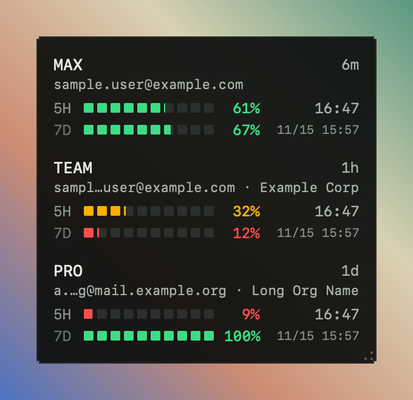
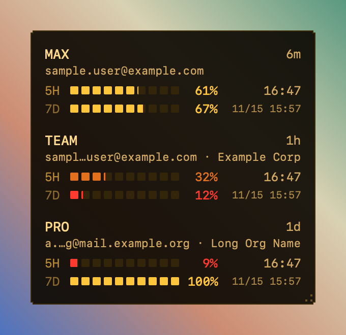
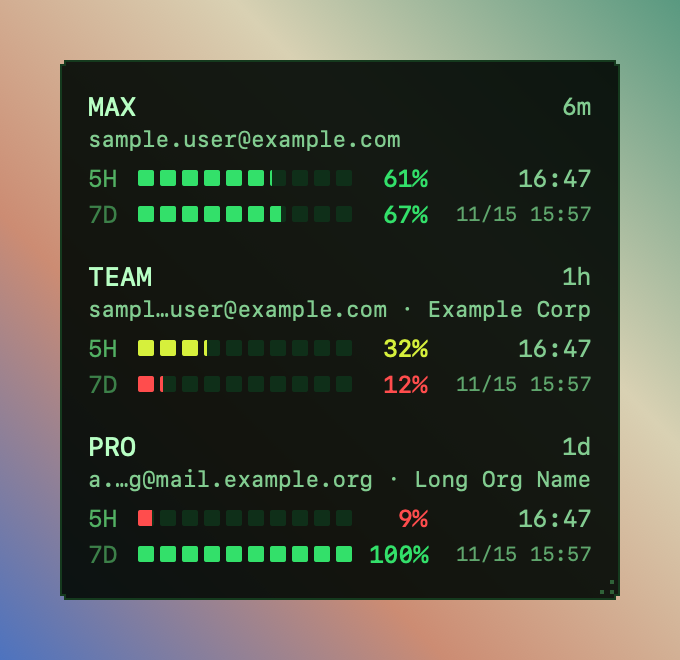
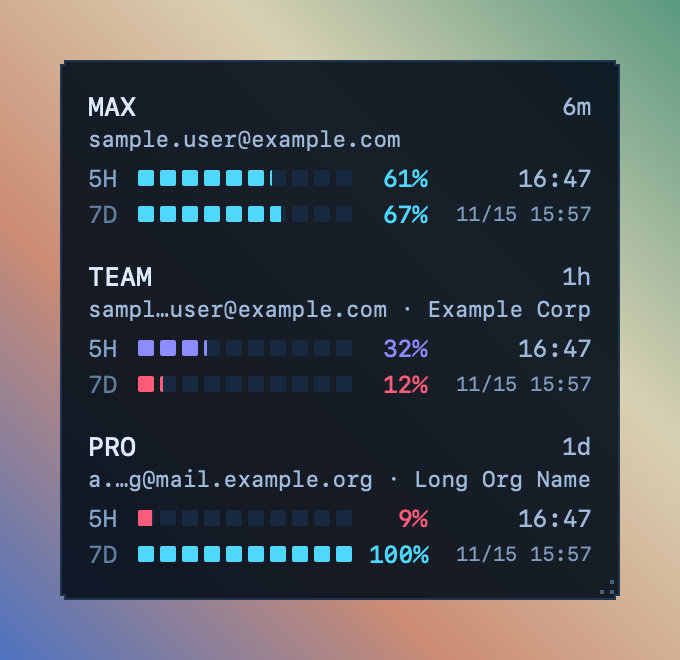
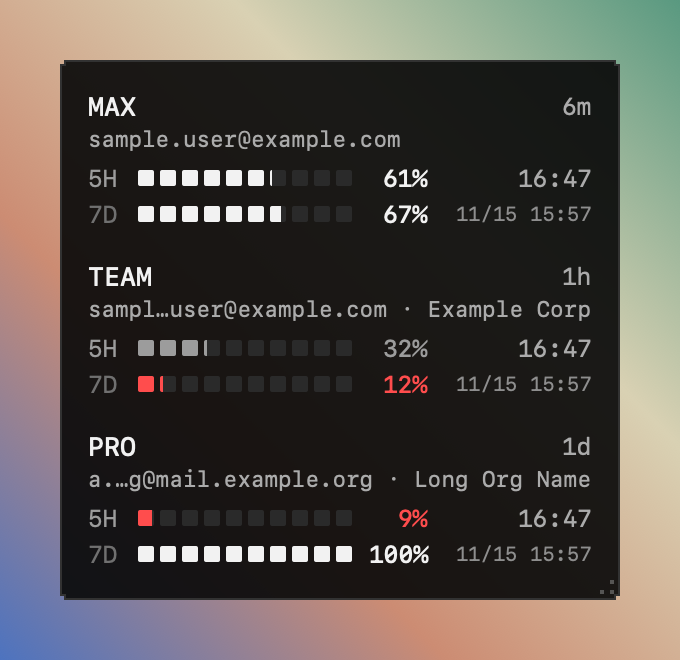
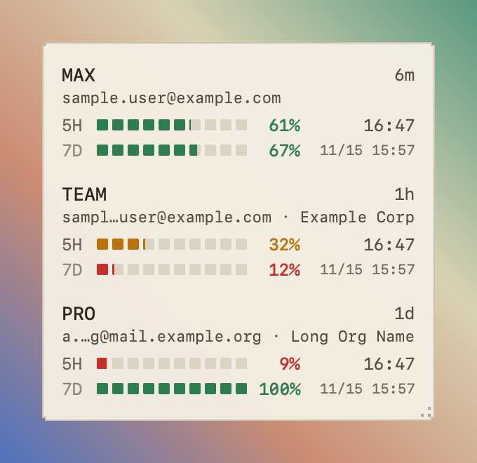

<div align="center">

# claude-usage-hp

**Your Claude plan limits as a game-style HP bar, always on screen.**


English | [한국어](README.ko.md)



<sub>Sample data, Terminal theme.</sub>

</div>

## Why

Checking how much of a Claude plan is left usually means keeping a usage page open in a browser. This project puts the two numbers that matter, what is left of the 5-hour window and of the weekly window, in a small always-visible HUD and in the menu bar. By default it does so without reading any login token: it only records what Claude Code sessions on your Mac are already told.

## Features

- **Several plans at once.** Each plan gets its own block, including two plans that sit under the same email address (they are told apart by organization).
- **5-hour and weekly remaining**, each drawn as a row of 10 square dots with the remaining percentage beside it. The last lit dot can be partly filled, so 61% is six dots and a sliver of the seventh.
- **Colour by how much is left**: the theme's "good" colour above 50%, its warning colour from 20% to 50%, its "low" colour below 20%.
- **Plan and account header.** Line 1 is the plan in capitals (`MAX`, `PRO`, `TEAM`, `ENTERPRISE`). Line 2 is the account email, followed by the organization's name when it has a real one. A long email is shortened in the middle so the domain stays readable.
- **Reset time** for every window, in local time; a reset on a later day also shows its date.
- **Age of each reading** (`now`, `4m`, `2h`, `3d`), so a stale number is visible as stale.
- **Dot-matrix terminal look**: a near-black square panel with notched corners and monospaced text, in six built-in colour themes.
- **Menu bar item** showing the most recently updated plan, for example `5h 61% · 7d 67%`. Its menu holds the actions: hide or show the HUD, theme, reading from the server, quit.
- **Always-on-top HUD** that never takes keyboard focus, shows on every Space and beside full-screen apps, can be dragged anywhere, and can be resized from its bottom-right corner (1.0x to 2.5x). It remembers its position and size, and can be hidden from the menu.
- **Optional custom names** per plan through a small `labels.json` file.
- **No tokens, no credentials, no network by default.** The app only reads local JSON files, unless you turn on [reading from the server](#reading-from-the-server-optional-off-by-default) for an account.

The menu bar item's menu is currently in Korean; the HUD itself uses short English labels.

## Themes

Six themes are built in. A theme changes colours only; the layout is the same in all of them. Pick one from the menu bar item's **테마** submenu. The choice is remembered.

| Terminal | Amber | Phosphor |
| :---: | :---: | :---: |
|  |  |  |
| **Ice** | **Mono** | **Paper** |
|  |  |  |

All images show sample data. Terminal is the default. Paper is the one light theme.

## How it works

```
Claude Code session
        │  each response reports the plan's rate-limit windows
        ▼
usage-hp mod  (silent: draws nothing)
        │  writes the latest reading, one file per plan
        ▼
~/.claude/usage-hp/<account>__<organization>.json
        │  watched: re-read the moment a file changes
        ▼
menu bar item + floating HUD
```

The mod runs inside Claude Code and has no interface of its own. The macOS app never talks to Claude or to any server; it only displays what the mod wrote.

## Requirements

- macOS
- Xcode command line tools, for `swiftc` (`xcode-select --install`)
- Claude Code
- A Claude subscription plan. Accounts that use an API key report no 5-hour or weekly window, so nothing is shown for them.

## Installation

1. Clone the repository.

   ```bash
   git clone https://github.com/dudwns0921/claude-usage-hp
   ```

2. Install the mod. Replace `<repo folder>` with the absolute path of the cloned folder.

   ```bash
   claude plugin marketplace add <repo folder>
   ```

   ```bash
   claude plugin install usage-hp@claude-usage-hp
   ```

3. If you also run Claude Code with a second config directory (`CLAUDE_CONFIG_DIR`), install the mod there too. Plugins are installed per config directory.

   ```bash
   CLAUDE_CONFIG_DIR=<other config dir> claude plugin marketplace add <repo folder>
   ```

   ```bash
   CLAUDE_CONFIG_DIR=<other config dir> claude plugin install usage-hp@claude-usage-hp
   ```

4. Build the app.

   ```bash
   <repo folder>/menubar/build.sh
   ```

5. Start it.

   ```bash
   <repo folder>/menubar/usage-hp-menubar &
   ```

6. Restart any Claude Code session that was already open so it loads the mod. After a session receives one response, its plan appears at once.

### Start at login (optional)

1. Copy `menubar/com.local.usage-hp-menubar.plist.example` to `~/Library/LaunchAgents/com.local.usage-hp-menubar.plist`.
2. In the copy, replace `__BINARY_PATH__` with the absolute path of the built `usage-hp-menubar`.
3. Quit the running instance, then register the agent.

   ```bash
   pkill -x usage-hp-menubar
   ```

   ```bash
   launchctl bootstrap gui/$(id -u) ~/Library/LaunchAgents/com.local.usage-hp-menubar.plist
   ```

To turn it off again:

```bash
launchctl bootout gui/$(id -u)/com.local.usage-hp-menubar
```

```bash
rm ~/Library/LaunchAgents/com.local.usage-hp-menubar.plist
```

## Usage

- **HUD**: drag it anywhere to move it. Each block is one plan; `5H` is the 5-hour window and `7D` the weekly window. The dots and the percentage show what is **left**, not what is used. With no reading yet it shows one line, `측정값 없음`.
- **Resizing**: the three small squares in the HUD's bottom-right corner are a resize grip. Drag it to scale the whole HUD uniformly, from 1.0x (the base size, also the minimum) up to 2.5x. Double-click it to go back to 1.0x. The scale is remembered.
- **Menu bar item**: the title follows the most recently updated plan and turns orange at 50% or less left, red below 20%. Plan details are shown in the HUD only; the menu holds the actions below.
- **Updates are immediate**: the app watches `~/.claude/usage-hp/` and redraws as soon as the mod writes a reading, so there is nothing to press. A 30-second timer remains only for what no file change announces: the age beside each plan growing (`now` to `1m`) and a window going back to 100% when its reset time passes.
- **플로팅 창 숨기기 / 보이기** hides or shows the HUD. The choice is remembered.
- **테마** switches the colour theme.
- **서버에서 읽기** chooses the accounts that are read from Anthropic's server; see [below](#reading-from-the-server-optional-off-by-default). Off for every account by default.
- **종료** quits the app.

### Custom names (optional)

Create `~/.claude/usage-hp/labels.json` to give a plan your own name. It replaces the plan line in the HUD and is shown as typed. The key is the plan's organization id, which is the `organizationId` value inside that plan's file in the same folder.

```json
{ "<organization id>": "Work team" }
```

### Reading from the server (optional, off by default)

The mod only learns a plan's numbers when a Claude Code session on this Mac gets a response. If a plan is mostly used elsewhere (another device, a remote agent), its block goes stale. For such a plan you can let the app ask Anthropic's server directly.

- **Turning it on**: open the menu, then **서버에서 읽기**, and tick the account. It is per account; every account is unticked until you tick it. Untick it to turn it off. An account with no terminal login on this Mac is greyed out (`터미널 로그인 없음`).
- **Logins in the default config folder (`~/.claude`) are not supported yet**: such an account is greyed out (`기본 폴더 로그인은 아직 지원 안 함`). The Claude desktop app shares that folder's `.claude.json` and can change the organization it names while the Keychain still holds the terminal's login for another one, so a reading could land under the wrong plan. Only logins in a separate config folder (`~/.claude-<name>`, used with `CLAUDE_CONFIG_DIR`) can be ticked; when an organization is logged in in both, the separate folder is the one used.
- **What a ticked account does**: at once (up to 30 seconds later if a request for another account is still out), and then every 5 minutes, the app reads that account's Claude Code login from the macOS Keychain (with `/usr/bin/security`), sends one `GET https://api.anthropic.com/api/oauth/usage` with it, and writes the answer to the same file in `~/.claude/usage-hp/` that the mod writes. **지금 갱신** asks right away. Polling pauses while the Mac sleeps, and after a failed request the wait grows, up to 60 minutes, or longer when the server's `Retry-After` asks for longer.
- **The login is checked against the account first**: before asking for usage, the app asks the server (`GET https://api.anthropic.com/api/oauth/profile`) which organization the login in the Keychain belongs to, and if it is not the ticked account's (for example right after a `/login` to another organization) it asks for nothing more and writes nothing; the line says `다른 조직으로 로그인됨`. The answer is remembered in memory only, so this costs one extra request each time the login is renewed and once after the app starts, not one per poll. A login that carries no expiry time is not remembered and is asked about on every poll; the logins Claude Code writes carry one.
- **Unticked accounts are untouched**: no Keychain read, no request. This holds per config folder: if a ticked account's folder has since been logged in to another organization, the login now in that folder is read and the one profile request above is sent with it. The Keychain item of the default config folder is never read, ticked or not.
- **The token is not kept**: it is read for each attempt, used for that attempt's requests and dropped. It is never written to a file, preferences or a log, never passed on a command line, and never refreshed; the app writes nothing to the Keychain.
- **In the HUD**: a ticked account carries a small `SERVER SYNC` tag left of its age (`SERVER SYNC 2m`), filled with the theme's colour for a well-filled bar. It is a label, not a button. If the last attempt failed the tag reads `SERVER FAIL` and is filled with the theme's red (`SERVER FAIL 3h`), and the last numbers stay; the reason is on that account's line in the submenu. The menu bar title does not change while a request is out.
- **When the login has expired**: the app does not refresh it. Run `claude` once with that account's config directory and Claude Code renews it; the app picks the new one up by itself.

Know before you tick:

- **The endpoint is undocumented.** Its address, headers and answer were taken from public tools that use it. It can change or be closed at any time, and Anthropic has not said that using a Claude Code login outside Claude Code is allowed. If it stops working, only this mode stops; the mod keeps feeding the HUD.
- **The token can do more than read usage.** It is the login of the whole account. That is why it is only read for ticked accounts and never stored, but it does pass through this app's memory every 5 minutes.
- **The request limit is shared with Claude Code.** Claude Code asks the same endpoint, and it is known to rate-limit; polling here can occasionally make Claude Code's own usage screen fail, and the other way round.
- **macOS may ask for permission** to let `security` read the item. If it does, "Always Allow" applies to `security`, not to this app.
- Only config directories directly under your home folder are found: `~/.claude` and `~/.claude-*`.

## Privacy & security

What the mod reads:

- the rate-limit windows Claude Code hands it for the current session (percentage used and reset time);
- the environment variables `HOME`, `CLAUDE_CONFIG_DIR`, `CLAUDE_CODE_USER_EMAIL`, `CLAUDE_CODE_ORGANIZATION_UUID` and `CLAUDE_CODE_ENTRYPOINT`;
- the `oauthAccount` entry of Claude Code's `.claude.json`, for the account email, organization id, organization name and plan type. This entry holds no token.

What the mod writes:

- one JSON file per plan in `~/.claude/usage-hp/`, containing the account email, organization id, organization name and plan type when known, the session's entry point, a timestamp and the windows.

What the app reads and writes:

- it reads the JSON files in `~/.claude/usage-hp/`, including the optional `labels.json`;
- it stores the HUD position, its scale, its visibility and the chosen theme in its own macOS preferences;
- only for accounts you tick under **서버에서 읽기**: it reads that account's Claude Code login from the Keychain, sends GET requests to `api.anthropic.com` (a profile request when the login is new or renewed, then the usage request), and writes the answer to that organization's file in `~/.claude/usage-hp/`, the same file the mod writes.

Nothing else, by default. No OAuth token, session cookie, API key or Keychain item is read. Neither part makes a network request, and nothing leaves your Mac.

The one exception is opt-in. To list the accounts under **서버에서 읽기**, the app reads the `oauthAccount` entry of the `.claude.json` files under your home folder (no token is there). For each account you tick, it reads that account's Claude Code login from the Keychain, sends it to `api.anthropic.com` in one usage request every 5 minutes (plus one profile request when the login is renewed), and stores the ticked organization ids in its preferences. The token is not stored, logged or refreshed. See [Reading from the server](#reading-from-the-server-optional-off-by-default).

Note that the files in `~/.claude/usage-hp/` contain your account email in plain text, and the HUD shows it on screen; both stay local.

The app makes one undocumented CoreGraphics call (`CGSSetConnectionProperty` with `SetsCursorInBackground`), solely so the resize cursor can appear over the HUD's corner while the app is in the background; it is looked up at run time, and the app works without it.

## Limitations

- **A plan appears only after it has been used once on this Mac in a Claude Code session.** Being signed in is not enough.
- **Values are as of the last response received on this Mac.** Use on other devices or on the web counts toward the server's numbers, but shows up here only after the next response on this Mac for that plan. The age shown beside each plan tells you how old the reading is.
- **A window whose reset time has passed is shown as 100% remaining.** The real value arrives with the next response.
- **The app is macOS only.** The mod writes its files on other systems too, but there is nothing there to display them.
- The app is built locally and is not signed or notarized.

## Troubleshooting

**A plan is not showing**

- Use that plan once in a Claude Code session on this Mac and wait for a response.
- Make sure the mod is installed in the config directory that session uses (see step 3 of Installation), and that the session was started after installing.
- A reading appears as soon as the session writes it; there is no need to wait or to re-read by hand. If nothing appears after a response, the session is not writing: check the two points above.

**Two menu bar items appear**

- Two instances are running. Quit the extra one with **종료**, or run `pkill -x usage-hp-menubar` and start the app once.

**The numbers look old**

- Check the age shown beside the plan. Send any message in a Claude Code session on that plan to refresh it.

## Uninstall

```bash
pkill -x usage-hp-menubar
```

```bash
claude plugin uninstall usage-hp@claude-usage-hp
```

```bash
claude plugin marketplace remove claude-usage-hp
```

If you set up start at login, run the two commands that turn it off as well. Delete `~/.claude/usage-hp/` to remove the recorded readings.

## Development

The app has a few options for working on the look without touching real data: `--snapshot <png>` draws the panel to a PNG file and exits, `--data-dir <dir>` reads the readings from another folder instead of `~/.claude/usage-hp/`, `--theme <name>` draws in that theme, `--scale <n>` draws at that size (1 to 2.5), and `--hover-grip` draws the resize corner as it looks under the pointer. `--data-dir` also works without `--snapshot`, to run the app on sample files, and setting `USAGE_HP_DEBUG=1` makes it say on stderr when the watched folder changes. The images in `docs/` were made this way from sample files.

## Contributing

Issues and pull requests are welcome. Please keep the core promise intact: no credentials are read and no network requests are made.

## License

[MIT](LICENSE)
